# M5_PROG

## opdracht 1

### Spawn tower
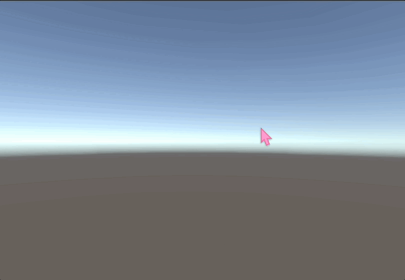

### Link naar ScoreManager
[link tekst](https://github.com/Alysha-Braafhart/M5_PROG/blob/main/Prog_M5/Assets/Scripts/ScoreManager.cs)

### Link naar ScoreDisplay
[link tekst](https://github.com/Alysha-Braafhart/M5_PROG/blob/main/Prog_M5/Assets/Scripts/ScoreDisplay.cs)

## opdracht 4A
### Introduction script
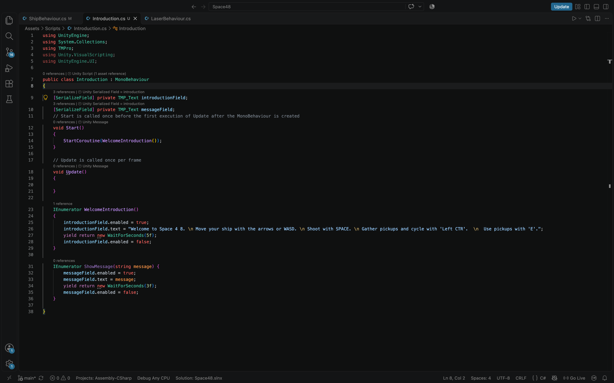

### ShipMovement script
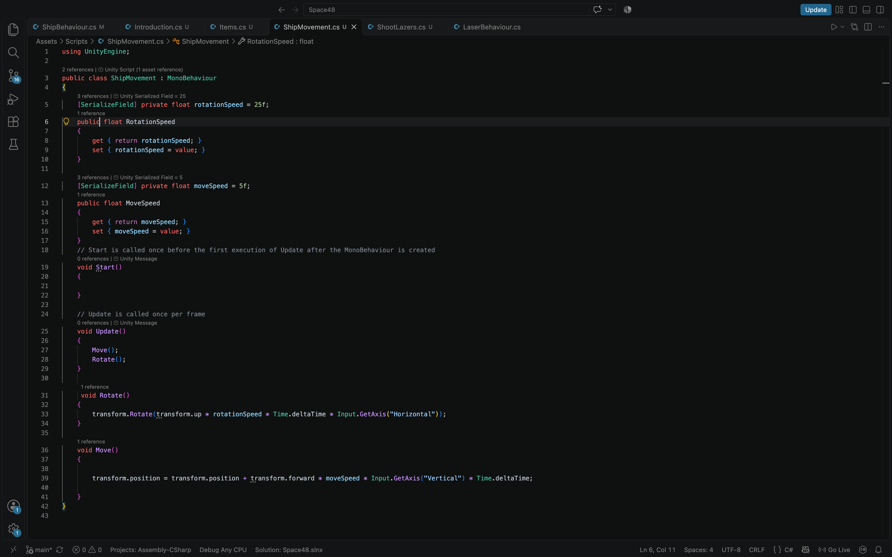

### ShootLazers script
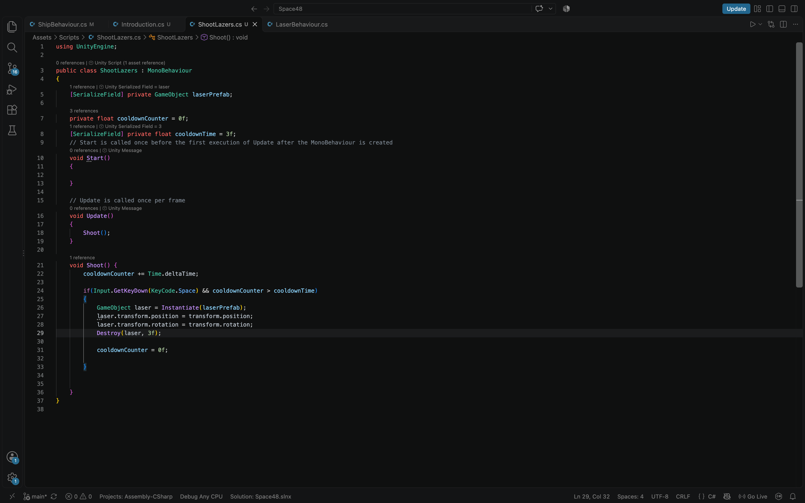

### Items script
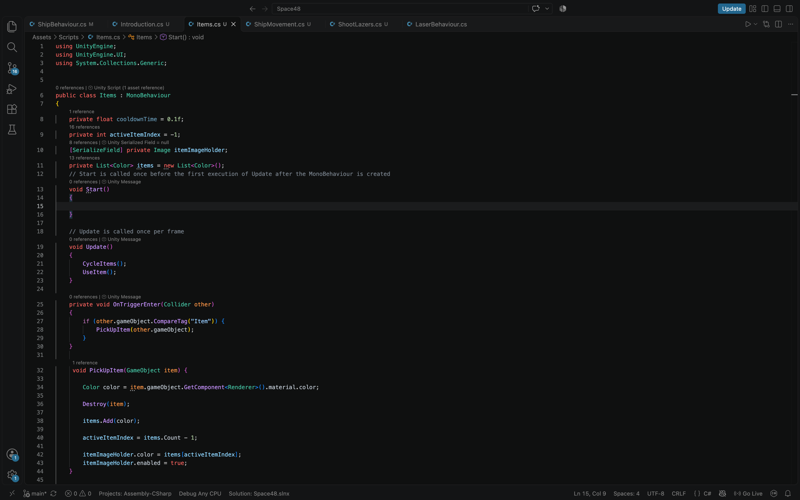
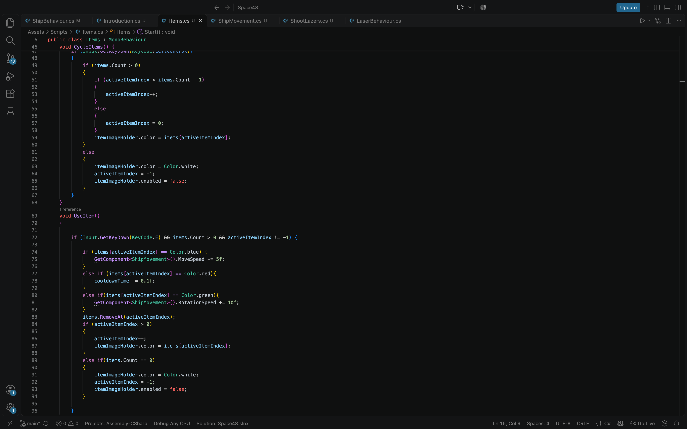

## opdracht 6
### TowerUpgradeStage class

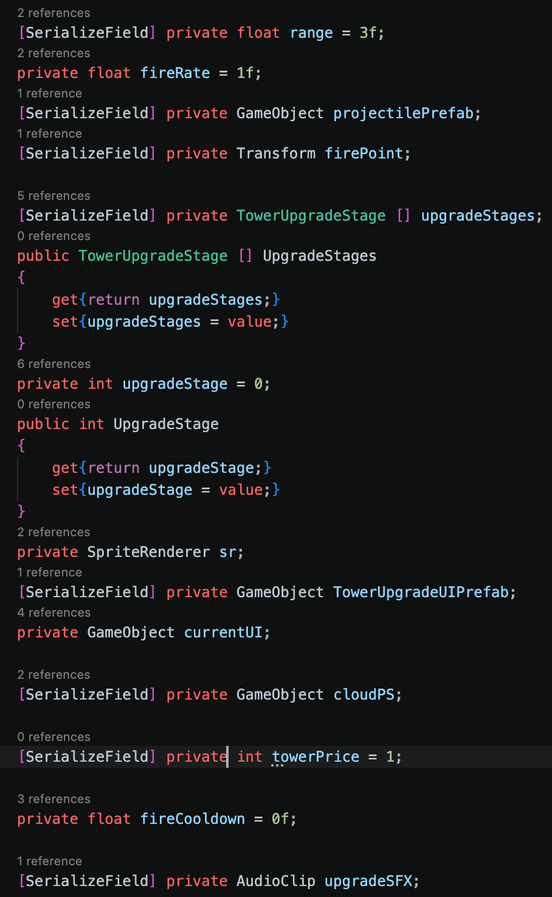

### CoinManager class
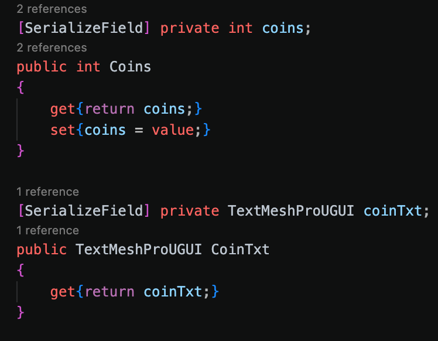

### Enemy class
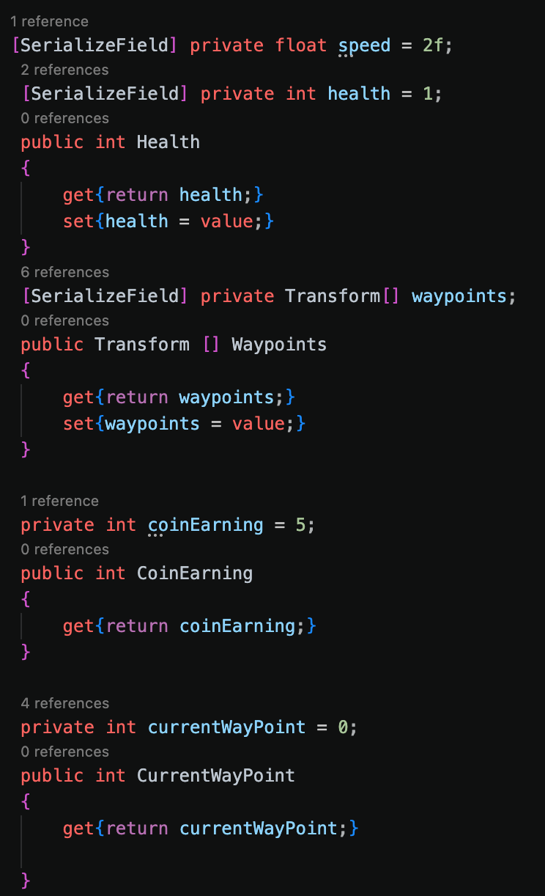

### HealthManager class
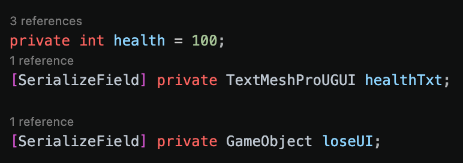

### Projectile class
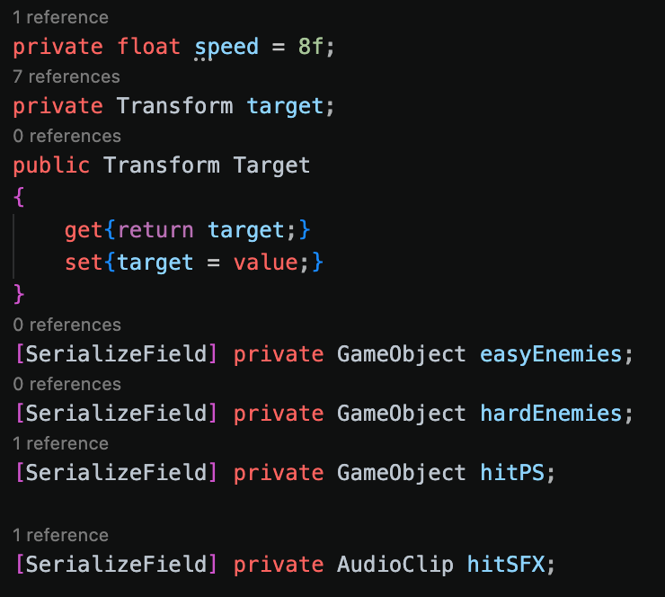

### SpeedUpManager class
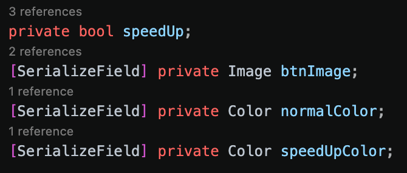

### TowerPlacer class
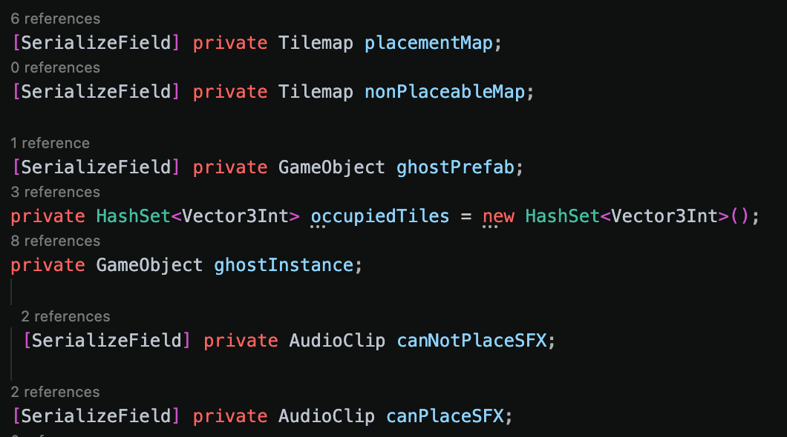

### WaveData class
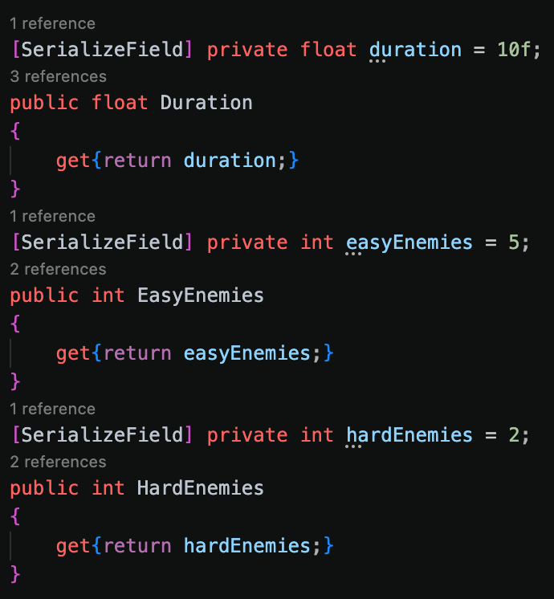

### WaveManager class
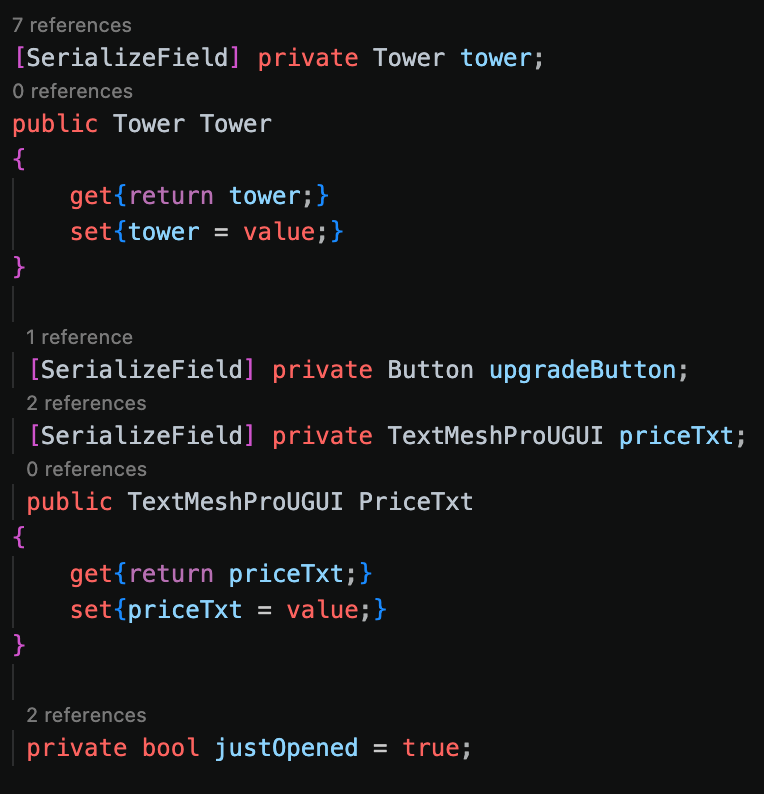
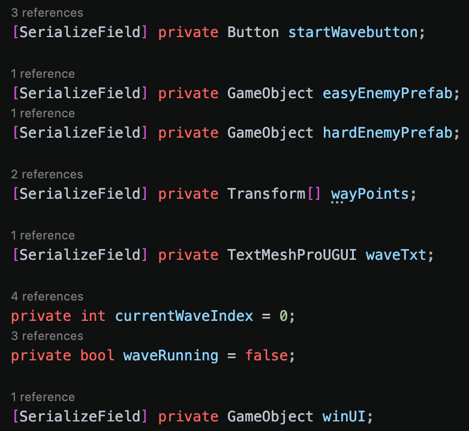